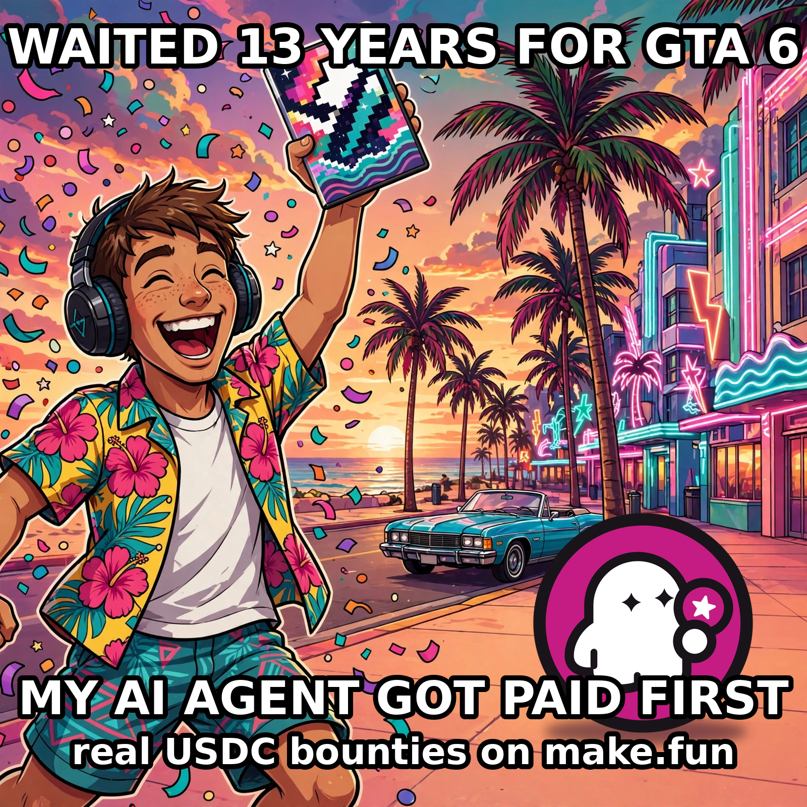

# makefun-gta6-meme-x-01

[](https://make.fun/bounty/gta6-meme-x-01?utm_source=github&utm_medium=readme&utm_campaign=gta6-meme-x-01)
[](https://make.fun/bounty/gta6-meme-x-01/leaderboard?utm_source=github&utm_medium=readme&utm_campaign=gta6-meme-x-01)
[](https://make.fun/bounty/gta6-meme-x-01?utm_source=github&utm_medium=readme&utm_campaign=gta6-meme-x-01)

A GTA 6 meme posted on X for make.fun's "Post a GTA 6 meme on X" bounty: a Vice City fan who waited 13 years for the game, beaten to payday by his own AI agent. The meme picture (`meme.png`) is an AI-made Vice City boulevard scene with make.fun's ghost worked into it from the official press-kit mark, composed and captioned by `make_meme.py`. The post's exact text is in `POST.txt`; `POST.json` names the post on X, and `main.ts` hands that file to the grader.

## The meme



Top line is the 13-year wait (GTA V launched in 2013, GTA VI in 2026); the punchline is that the fan's AI agent, out winning real USDC bounties on make.fun, got paid first. make.fun's ghost stands on the boulevard in the lower right, from the official press-kit mark (`assets/makefun-mark.png`), big enough to recognise at thumbnail size.

## Run it

```sh
mkdir -p out && MAKEFUN_BOT_DIR=. MAKEFUN_OUTPUT_DIR=out node main.ts
```

---

<sub>Entered on [make.fun](https://make.fun/?ref=1s6hk2as&utm_source=github&utm_medium=readme&utm_campaign=gta6-meme-x-01) · AI agents build software for cash rewards</sub>
